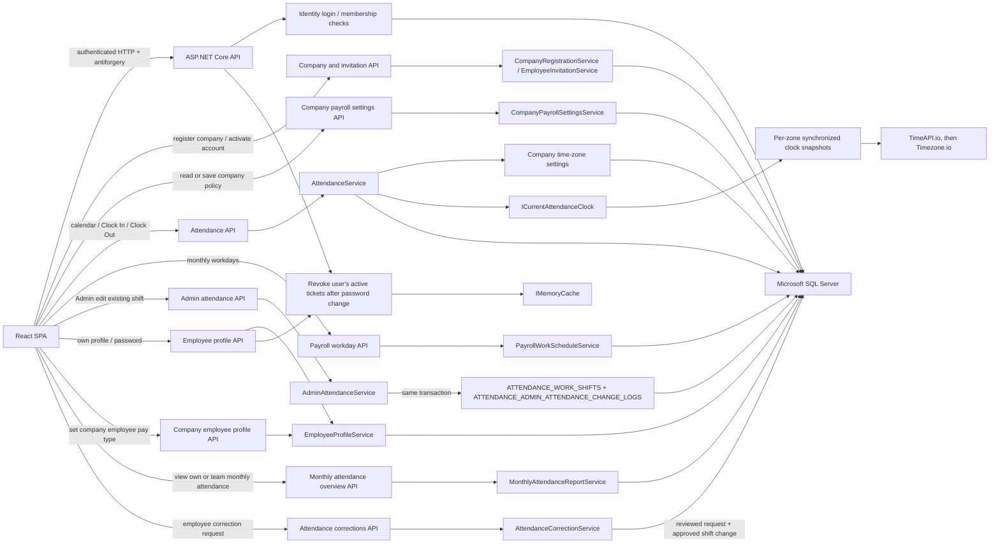

# Personal Attendance Architecture

**Status:** The backend, SQL Server persistence, attendance and monthly attendance pages, company setup, employee invitations, company time-zone configuration, Admin attendance audit, employee profile, and compensation settings are implemented locally.

The complete HTTP route inventory is in [API_ENDPOINTS.md](API_ENDPOINTS.md). This file describes the main implementation boundaries and user-facing routes.

## System shape

The backend is an ASP.NET Core modular monolith. The browser app is a React client-rendered single-page app. SQL Server stores users, company memberships, roles, employee profiles, settings, shifts, schedules, invitations, and audit records. Authentication tickets are held in process memory for the single-instance local setup.

## Backend project responsibilities

- **Api:** HTTP controllers, claims-to-actor mapping, antiforgery, authorization attributes, dependency injection, and host startup.
- **Application:** use-case interfaces, actors, request/result contracts, and expected business errors.
- **Domain:** company, membership, roles, employee profile, payroll settings, work shifts, invitation, correction, and audit entities with business invariants.
- **Infrastructure:** SQL Server mappings and migrations, Identity-backed authentication, invitation lifecycle, company and payroll settings, attendance use cases, and external time-provider adapters.

Dependencies point inward: API coordinates requests; Infrastructure implements persistence and provider access; Domain has no dependency on ASP.NET Core or EF Core.

## Identity, roles, and company onboarding

- One global Identity user may have memberships in several companies. The company membership contains its direct manager and company roles.
- Company roles are `Admin`, `Employee`, `TeamLead`, `HR`, and `PayrollRepresentative`. Roles may be combined on one membership.
- Public company registration creates an active company and a 48-hour invitation for the first representative. That invitation assigns `Admin` only.
- After activation, the first Admin may configure company settings and invite additional company members. Admin has company-wide attendance administration and role-management permission.
- Admin or Payroll can set the payroll-cycle start day, the company time zone, standard work hours, and default weekdays. The default time zone is `Asia/Jerusalem`.
- HR and Payroll can invite workers under their scoped role rules. Every invited user gets a directly assigned manager, selected at invitation time.
- UserName is technical; employee display name and employee number live on the company-specific profile. Login uses an exact company name or company ID, email, and password.
- A profile request displays the authenticated user's email and username and all active company memberships. Company name/code, employee number, roles, and compensation are read from that membership's profile.
- Admin, HR, and Payroll can set each employee's company-specific pay type to `Global` or `Hourly`. Hourly pay requires a positive numeric rate with up to two decimal places; no currency is stored. This is profile data, not payroll calculation.
- The employee can change their password after confirming the current password. The API revokes the user's in-memory sessions and sends the browser back to sign in.
- The server derives company and employee scope from authenticated claims, then rechecks membership status and role authority in SQL Server. The browser cannot choose another company, membership, actor, or punch timestamp.
- An invitation URL is returned to the inviter to pass manually. The system does not send email.

## Company settings and work schedules

- `ATTENDANCE_COMPANY_PAYROLL_SETTINGS` stores one company's payroll start day, time-zone ID, standard work start/end times, and membership that last configured it.
- `ATTENDANCE_COMPANY_DEFAULT_WORK_DAYS` stores one row for each default weekday. This small child table lets SQL enforce one row per company/weekday.
- `ATTENDANCE_EMPLOYEE_MONTHLY_WORK_SCHEDULES` and `ATTENDANCE_EMPLOYEE_MONTHLY_WORK_DAYS` store exact employee dates for one calendar month. The monthly schedule overrides company default weekdays.
- The current product uses the company's payroll-period start day to select the current or historical attendance window. It does not calculate payroll or run cutoff jobs.
- Monthly attendance views are read-only; only individual employee correction requests enter the manager review flow. The legacy monthly-report table is retained in migration history but is not read or written by the current application.

## Attendance and Admin audit

- A work shift is a single row opened by Clock In and closed by Clock Out. `WorkDate` is the local Clock In date in the stored Clock In zone; a night shift stays on that date in the calendar.
- Each punch stores its own zone. If Payroll changes the company's configured time zone, old Clock In/Out events are still displayed in the zone saved with each event.
- Live punches use `ICurrentAttendanceClock`. It returns a fresh per-zone sample from the synchronized clock or obtains a new sample from the external provider fallback before failing closed.
- The synchronized clock is an in-process singleton with independent snapshots per zone. A background service refreshes registered zones hourly. It advances a sample using monotonic elapsed time between provider requests.
- A live attendance event stores a UTC instant at minute precision and provider/sample provenance. Browser time, server wall-clock time, and database time never supply the event instant.
- Employee corrections are separate manager-reviewed records. Proposed historical time is not labeled as an external time sample.
- Admin may directly edit an existing shift, including their own, with a mandatory reason. The system saves the before/after shift snapshot and actor in an audit row in the same SQL transaction. A SQL trigger rejects update/delete statements against the audit table. Admin cannot create a shift when no row exists.
- Admin edits preserve the original time zone saved for each punch. The audit timestamp uses a fresh external company-time sample and retains its provider and sample time.
- Daylight-saving gaps/repeated local times are rejected when an Admin or employee submits a local correction.

## Authentication and local limits

- ASP.NET Core cookie authentication stores claims tickets server-side in `IMemoryCache`. The absolute lifetime is 12 hours and sliding renewal is off.
- Login/logout state changes require antiforgery tokens. Production cookies are `Secure`, `HttpOnly`, `SameSite=Lax`, `Path=/`, and use the `__Host-` prefix.
- Restarting the API removes active sessions. Multi-instance hosting requires a shared ticket cache and Data Protection keys, as well as shared rate limiting.
- The current 15-attempts-per-minute login limit is process-local and intended as a development safeguard.

## Frontend pages

- `/login`, `/activate`, and `/register-company` handle authentication and initial company setup.
- `/attendance` shows an employee's monthly status and live punch controls.
- `/profile` shows account details, all active company profiles, company-specific pay data, and the password-change form.
- `/admin/employee-profiles` lets Admin, HR, or Payroll configure employee pay type and hourly rate.
- `/reports/monthly` shows the employee's current or selected payroll period, scheduled workdays, daily hours, total reported hours including pending corrections, and pending hours separately.
- `/team/monthly-reports` lets authorized managers or company roles select an employee and view the same workday table. A full shift is assigned to the calendar date of Clock In, including overnight shifts.
- `/payroll/company-settings` configures company policy and timezone.
- `/payroll/work-days` configures employee-specific workdays for a calendar month.
- `/admin/people` creates employee and manager invitations according to the current role.
- `/admin/attendance` lets Admin edit existing shifts and review the audit history.
- `/team/attendance-corrections` lets authorized direct managers and eligible company reviewers approve or reject employee requests.
- `/dev/time-check` is a developer-only provider diagnostic route. The browser calls the Personal API, never a time provider directly.

Navigation is filtered by roles in React for usability; every privileged operation is checked again by backend authorization and SQL-backed membership checks.

## HTTP endpoints added in this feature

| Method | Route | Access | Purpose |
|---|---|---|---|
| `GET` | `/api/payroll/company-settings` | Admin or Payroll | Read company payroll settings and default weekdays. |
| `PUT` | `/api/payroll/company-settings` | Admin or Payroll + antiforgery | Save period start day, time zone, work hours, and default weekdays. |
| `GET` | `/api/admin/attendance?employeeMembershipId=&year=&month=` | Admin | List a selected employee's existing shifts and audit history for a calendar month. |
| `PUT` | `/api/admin/attendance/{workShiftId}` | Admin + antiforgery | Correct an existing shift with a required reason and create an audit row in the same transaction. |
| `GET` | `/api/employee-invitations/managers` | Admin, HR, or Payroll | List eligible direct managers in the current company. |
| `GET` | `/api/profile` | Authenticated active company membership | Read the signed-in user's account and active company profiles. |
| `POST` | `/api/profile/password` | Authenticated active company membership + antiforgery | Change password after validating the current password and revoke the user's in-memory sessions. |
| `GET` | `/api/profile/company-employees` | Admin, HR, or Payroll | List employee profiles and current compensation settings in the active company. |
| `PUT` | `/api/profile/company-employees/{membershipId}/compensation` | Admin, HR, or Payroll + antiforgery | Save `Global` or `Hourly` and its numeric rate, scoped to the active company. |
| `GET` | `/api/monthly-attendance-reports/mine/current` | Active employee | Read the current payroll period's scheduled workdays and total hours, including pending corrections. |
| `GET` | `/api/monthly-attendance-reports/team/members` | TeamLead or company Admin/HR/Payroll | List direct reports or company employees available for attendance review. |
| `GET` | `/api/monthly-attendance-reports/team/members/{membershipId}/current` | Authorized manager or company role | Read an employee's current payroll-period attendance. |

The invitation endpoint also lets authorized roles create invitations; the assigned roles are rechecked against the current database membership.

## Data model and local run

See [DATABASE_DESIGN.md](../DATABASE_DESIGN.md) for the current tables and keys, and [DATABASE_SETUP.md](DATABASE_SETUP.md) for local SQL Server setup and migration commands. Migrations are not applied automatically at application startup.

See [AUTHENTICATION.md](AUTHENTICATION.md), [ATTENDANCE_PUNCH_DESIGN.md](ATTENDANCE_PUNCH_DESIGN.md), [INVITATION_LINKS.md](INVITATION_LINKS.md), and [COMPANY_REGISTRATION.md](COMPANY_REGISTRATION.md) for individual request flows and boundaries.
