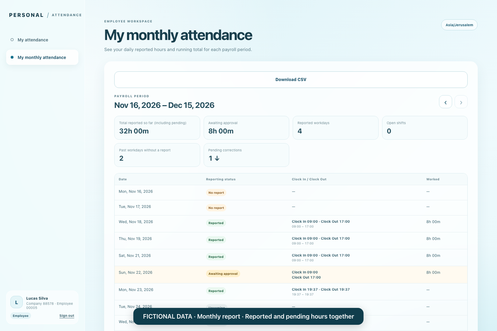

# Product demo

[Watch the 34-second demo](attendance-demo.mp4)



The recording uses a real local application and disposable SQL database. All people,
company names and account data are fictional. The company is Northstar Studio and the
sample team includes Alex Morgan (Admin), Sofia Rossi (Payroll), Kenji Tanaka (HR),
Amara Okafor (Team lead) and Lucas Silva (Employee). No real employee information,
passwords, activation links or API credentials are included. The video has English captions
and no audio.

The tour shows live Clock In/Out, a historical correction, pending hours in the monthly
report, CSV download, manager approval, company settings and member invitations.
Google OAuth and LLM assistance are not demonstrated.

To record again against a disposable API and database serving http://127.0.0.1:5178:

```bash
cd src/frontend/personal-web
npx playwright test --config playwright.demo.config.ts
```

Recordings are written under ignored `test-results/demo-media`. The demo creates a new
synthetic company for each run. Do not record against production employee data.
The test password is synthetic and is only used during off-screen setup.

To convert the generated recording (requires ffmpeg):

```bash
ffmpeg -i test-results/demo-media/attendance-demo.webm -map_metadata -1 \
  -c:v libx264 -crf 24 -pix_fmt yuv420p -movflags +faststart -an attendance-demo.mp4
```
